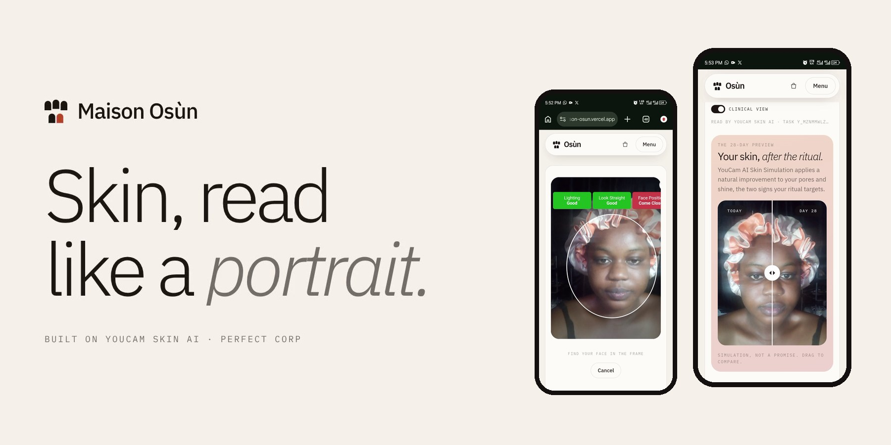
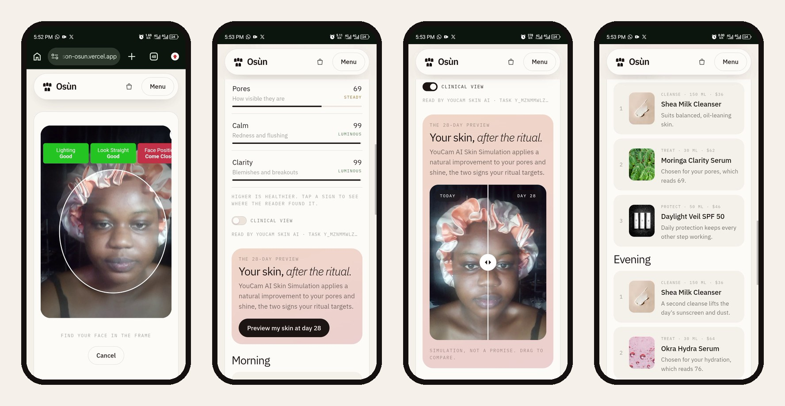
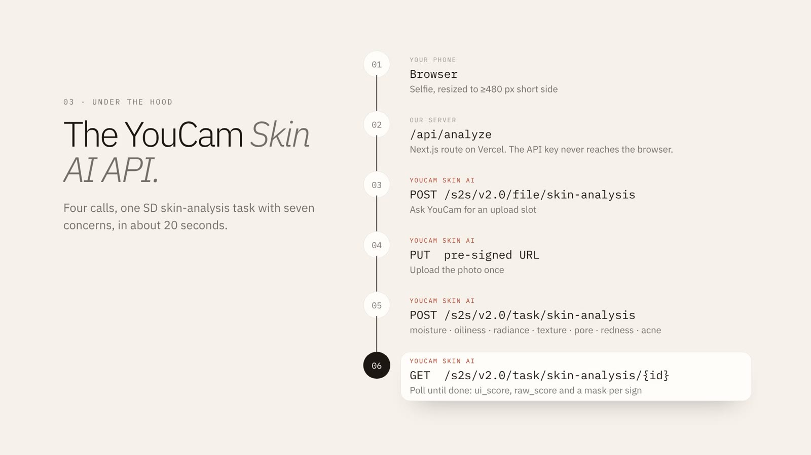
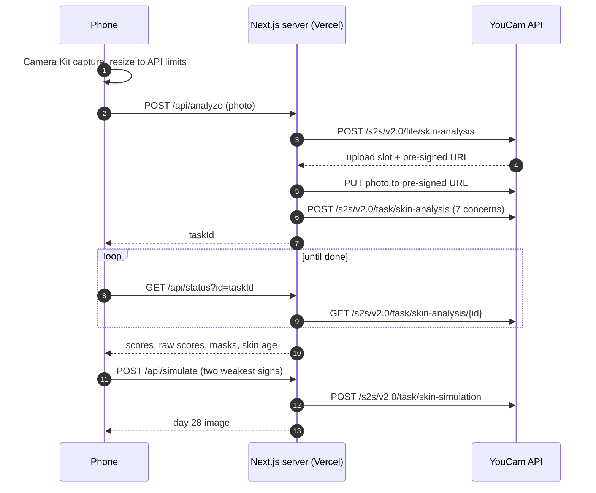

<div align="center">


# Maison Osùn

**Skin, read like a portrait.**

A skincare house that reads your skin before it sells you anything.<br/>
One selfie becomes a skin portrait, a ritual made for you, and a preview of your own skin at day 28.

[](https://maison-osun.vercel.app)
[](https://yce.perfectcorp.com/)
[](https://nextjs.org)

Built for the **YouCam API Skin AI & eCommerce VTO Hackathon** by Perfect Corp.

<br/>



</div>

<br/>

## For judges: try it in 60 seconds

| Step | What to do |
| --- | --- |
| **1. Open** | [maison-osun.vercel.app/consult](https://maison-osun.vercel.app/consult) on your phone |
| **2. Sit** | Tap **Guided camera**. YouCam's Camera Kit checks your light, distance and angle, then takes the photo itself |
| **3. Read** | About 20 seconds later you land on your **skin portrait** |
| **4. Preview** | Tap **Preview my skin at day 28** and drag the slider |
| **5. Keep going** | **Start this ritual** to open the tracker, then visit the **Journal** |

> **No camera handy?** Tap **See a sample portrait** on `/consult`, and **Load a sample history** on `/journal`. Sample data is always labelled.

<br/>

## What it looks like, live on a real phone



<sub>Left to right: YouCam Camera Kit guiding the selfie, the seven-sign portrait, the AI Skin Simulation before/after, and the composed ritual.</sub>

<br/>

## The idea

Good skincare used to be personal: someone looked closely at your skin and handed you exactly what you needed. Online, that care gets lost in a shelf of 40 serums and a quiz.

**Osùn** is camwood, a red heartwood that families across West Africa have pressed onto their skin for generations. Maison Osùn brings back the luxury beauty counter, where someone reads your skin and hands you three things, for anyone with a phone.

<br/>

## Features

| | Feature | What it does |
| --- | --- | --- |
| 📷 | **Guided consultation** | YouCam **JS Camera Kit** in skincare mode coaches the selfie live and captures automatically. Selfie and upload work as fallbacks. |
| 🧬 | **Skin portrait** | **YouCam Skin AI** scores seven signs: hydration, oil balance, radiance, texture, pores, redness and blemishes. Plus overall score, skin age and skin type, and how each sign changed since your last reading. |
| 🗺️ | **Where it was found** | Tap any sign to lay YouCam's detection mask over your own photo. |
| 🔬 | **Clinical view** | One switch shows YouCam's unadjusted `raw_score` instead of the display score. Every live reading shows its YouCam task ID. |
| ✨ | **Day 28 preview** | **YouCam AI Skin Simulation** applies a natural improvement to your two weakest signs, on your own selfie, as a before/after slider. |
| 🧴 | **A ritual with reasons** | Morning and evening steps from a ten-product collection. Every product says which score it answers: *"For your pores score (69)."* |
| ✅ | **Ritual tracker** | Tick off each step, keep a streak, and count down to your next portrait on day 28. |
| 📈 | **Journal** | Every reading is saved on your device, with a trend chart for any sign over time. |
| 🛍️ | **Bag** | The whole ritual in one tap, with a concept checkout (no payment taken). |

<br/>

## Why it matters for retail

- **Bigger baskets.** The ritual sells as a bundle, not one product at a time.
- **Fewer returns.** Customers buy what matches their skin, not what looked nice on a shelf.
- **Built-in retention.** Day 28 brings the customer back for a new reading, which is the natural moment for a refill.
- **Confidence at checkout.** Seeing your own face improve is a stronger reason to buy than any product photo.
- **Brand-agnostic.** The ritual logic maps scores to products, so any skincare catalogue can be plugged in.

<br/>

## How the YouCam APIs are used





| YouCam product | Endpoint | Used for |
| --- | --- | --- |
| **Skin AI** | `POST /s2s/v2.0/file/skin-analysis` then `PUT` | Upload slot and photo upload |
| **Skin AI** | `POST /s2s/v2.0/task/skin-analysis` | Seven SD concerns: `moisture`, `oiliness`, `radiance`, `texture`, `pore`, `redness`, `acne` |
| **Skin AI** | `GET /s2s/v2.0/task/skin-analysis/{id}` | Scores, raw scores, masks, skin age |
| **AI Skin Simulation** | `POST /s2s/v2.0/task/skin-simulation` | Day 28 preview. The two weakest signs become intensities from 0.2 to 0.6 |
| **JS Camera Kit** | `faceDetectionMode: "skincare"` | Guided, automatic capture |

**The API key never reaches the browser.** Every YouCam call goes through Next.js route handlers in [`app/api/`](app/api).

<br/>

## Privacy by design

- Readings, ritual check-offs and the bag live **on the device** (`localStorage`). Nothing is stored on a server.
- The full-size selfie is kept only for the current session (`sessionStorage`), for the day 28 preview.
- Photos go to YouCam once for analysis. YouCam deletes uploads after 24 hours.
- Scores are cosmetic guidance, **not a medical diagnosis**.

<br/>

## Run it yourself

```bash
git clone https://github.com/midexol/maison-osun.git
cd maison-osun
npm install
YOUCAM_API_KEY=your_key npm run dev   # http://localhost:3000
npm test                              # both APIs end to end against a mock YouCam server
```

Get a key from the [YouCam API console](https://yce.perfectcorp.com/api-console/en/api-keys/). Without one, the app still runs with clearly labelled sample results.

**Deploy on Vercel:** import the repo, add `YOUCAM_API_KEY` under *Settings → Environment Variables*, and deploy. `/consult` shows **Connected to YouCam Skin AI** when the key is active.

<br/>

## Project structure

```
app/
  page.js                     Landing: hero, how it works, botanicals, FAQ
  consult/ portrait/ ritual/ journal/ bag/    The app
  api/analyze/route.js        Upload + start skin analysis
  api/simulate/route.js       Upload + start skin simulation
  api/status/route.js         Poll either task
  api/health/route.js         Is the YouCam key configured?
components/                   ConsultFlow, PortraitView, RitualView, JournalView, BagView, ...
lib/
  youcam.js                   YouCam client + result normaliser
  ritual.js                   Skin type, ritual and simulation logic
  store.js                    On-device storage
  client.js                   Photo prep, API calls, friendly errors
  data.js                     Products, signs, sample data
test/proxy.test.mjs           Route handlers against a mock YouCam server
```

<br/>

## Built with

**YouCam Skin AI API**, **YouCam AI Skin Simulation API**, **YouCam JS Camera Kit**, Next.js 14, React 18, Framer Motion, Lenis, Vercel

<br/>

## Credits

- Skin analysis and simulation by [YouCam / Perfect Corp](https://www.perfectcorp.com/business).
- Photography from [Unsplash](https://unsplash.com/license). Film loops from MotionSites.
- Type: IBM Plex Sans and IBM Plex Mono.
- Maison Osùn and its products are a concept brand made for this hackathon.

<div align="center">
<br/>

<br/>
<sub>Made by <a href="https://github.com/midexol">@midexol</a></sub>
</div>
